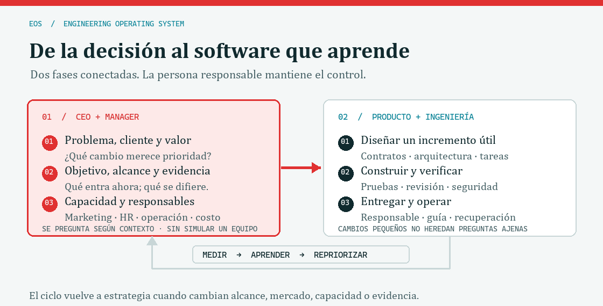

# Pierre R. Boss — Engineering Operating System

**EOS · Edición de especificaciones de ingeniería 4.4.0 · 19 de octubre de 2026 · Perú**

🧭 **Tu copiloto tiene mapa, frenos y bitácora. El volante sigue siendo tuyo.**

[Empezar](#despegue-en-tres-pasos) · [Instalar](#guía-por-host-paso-a-paso) · [Elegir skill](skills/README.md) · [Estado real](docs/EOS-PROJECT-STATUS.md) · [Licencia MIT](LICENSE) ([alcance](LICENSE-SCOPE.md))

## Despegue en tres pasos

Necesitas Git, Node.js 24 y acceso al repositorio privado. No hay `npm install`, Docker, Python, claves de API ni servicios de pago para instalar EOS. Los comandos siguientes se ejecutan en PowerShell, macOS o Linux; sustituye la ruta del proyecto por una carpeta existente.

```powershell
git clone https://github.com/oprbguitar/dev-funcy-agents-03-10-26.git
cd dev-funcy-agents-03-10-26
node scripts/install-agents.mjs --host codex --target "../mi-proyecto" --dry-run
```

1. **Mira el equipaje.** Revisa el plan de `--dry-run`: muestra qué archivos recibiría tu proyecto.
2. **Instala.** Repite el último comando sin `--dry-run`. Usa `--host claude` para Claude Code o `--host all` para ambos.
3. **Abre tu proyecto en el agente y dale una misión.** Copia este inicio:

```text
Aplica EOS 4.4.0 en MODE=ADOPT a este proyecto.
Lee AGENTS.md y .eos/EOS-CORE.md, inspecciona antes de editar y conserva mi trabajo.
Objetivo: [describe el cambio]. Primera entrega útil: [resultado observable].
Evalúa jurisdicción, datos, marca, landing, marketing y canal web/escritorio;
activa solo lo pertinente y justifica NOT_APPLICABLE.
Verifica los cambios y actualiza docs/EOS-PROJECT-STATUS.md en cada hito.
No publiques ni gastes sin una autorización aplicable.
```

**¿Proyecto nuevo?** Cambia `ADOPT` por `INIT`. **¿Solo revisar?** Usa `AUDIT`. Una instalación correcta crea `.eos/install-manifest.json`, el bloque EOS de `AGENTS.md` y las carpetas del host indicadas más abajo. EOS queda integrado al proyecto destino; clonar este repositorio por sí solo no lo instala en tus otros proyectos.

## Qué trae la mochila 4.4 🎒

### IA en Perú, calidad ISO y referencias UI/UX

EOS incorpora [PERU QUALITY](skills/eos-peru-quality/SKILL.md) para proyectos nuevos y existentes. Antes de activar IA o entregar un cambio material, registra sector público/privado, uso real de IA, datos, finalidad, responsables y riesgos. La [guía de fuentes y controles](docs/reference/AI-PERU-QUALITY.md) distingue obligaciones peruanas, estándares voluntarios, compromisos contractuales y pendientes de revisión. La [evaluación reutilizable](templates/AI-QUALITY-ASSESSMENT.md) conecta decisiones con evidencia, pruebas y seguimiento.

ISO 9001 orienta la gestión de calidad; ISO/IEC 27701, la gestión de privacidad; la NTP-ISO/IEC 42001 se evalúa para gestión de IA según el ámbito aplicable. Una ISO internacional y una NTC colombiana no prueban adopción NTP por INACAL. Los PDF aportados se conservan fuera del repositorio: aquí se publican procedimientos propios, referencias y límites, sin reproducir las normas completas ni afirmar certificación.

El [catálogo UI/UX y landing](docs/reference/LANDING-REPOSITORY-RESEARCH.md) integra los 25 candidatos aportados. Se eligen por tarea, audiencia, arquitectura, accesibilidad, rendimiento y licencia del commit. En INIT sirven para comparar alternativas; en ADOPT se parte del diseño y componentes existentes y se propone una mejora acotada. No se instalan todas las bibliotecas ni se trasladan efectos visuales por rutina. Pierre Design Director gobierna la dirección visual y las pruebas del producto destino.

```text
Aplica EOS 4.4.0 en MODE=ADOPT a este proyecto.
Evalúa eos-peru-quality: conexión con Perú, IA efectiva, datos y calidad ISO pertinente.
Completa AI-QUALITY-ASSESSMENT en la documentación del proyecto con responsables y evidencia.
Si cambia la UI, usa eos-landing-brand y compara referencias compatibles del catálogo.
Conserva arquitectura e identidad; verifica licencias antes de incorporar código o assets.
Actualiza EOS-PROJECT-STATUS y distingue implementado, probado y pendiente de revisión humana.
```

Para actualizar una instalación existente, ejecuta primero `node scripts/install-agents.mjs --host all --target "../mi-proyecto" --update --dry-run` y revisa el plan; repite sin `--dry-run` para aplicarlo. Las modificaciones locales se preservan como conflictos con propuestas `.eos-new`. En un host único usa `codex` o `claude`. El catálogo distribuye la nueva skill; el equipo receptor debe ejecutar sus controles y revisar sus evidencias.

| Capacidad | Actívala cuando… | Entrega concreta |
|---|---|---|
| [Privacidad y derecho](skills/eos-privacy-review/SKILL.md) | Cambien datos, finalidad, jurisdicción, cookies, IA o proveedores | Inventario, base por finalidad, decisiones y pruebas; revisión competente cuando corresponda |
| [Marca y landing](skills/eos-landing-brand/SKILL.md) | Haya UI, producto web público o captación comercial | Brief, tokens, landing dentro del alcance y claims respaldados |
| [Escritorio](skills/eos-desktop-release/SKILL.md) | Distribuyas Windows, macOS, Linux o híbrido | Instalación, almacenamiento, firma, actualización, desinstalación y recuperación |
| [Estrategia y marketing](skills/eos-strategy/SKILL.md) | Definas oferta, canales, prioridades o experimentos | Hipótesis, presupuesto propuesto, señales reales y criterio de parada |
| [Documento vivo](templates/PROJECT-STATUS.md) | Cada hito cambie el sistema | Estado, decisiones, evidencia, riesgos y siguiente paso en un registro canónico |

Una web comercial empieza con un blueprint de landing; una herramienta interna puede justificar `NOT_APPLICABLE`. Una página sin tratamientos que requieran consentimiento no recibe un banner ornamental. Los controles de cookies y escritorio se verifican en el producto receptor: las pruebas de EOS comprueban sus herramientas e instrucciones, no esos runtimes futuros.

La edición mantiene trece roles y amplía el catálogo a once skills. Perú es un perfil prioritario cuando corresponde al proyecto; la [matriz normativa](docs/reference/PRIVACY-PERU-REGISTRY.md) distingue fuentes verificadas, aplicabilidad y pendientes. [Licencias de referencias](docs/reference/LANDING-REPOSITORY-RESEARCH.md) y [sistema de marca](docs/reference/BRAND-AND-COLOR-SYSTEM.md) explican qué se puede estudiar y qué debe revisarse antes de copiar.

> Quiero software que pueda entender, verificar, proteger, mantener y entregar. Quiero que cada decisión tenga una razón, cada permiso un límite y cada resultado una prueba. La IA debe ampliar mi capacidad de trabajo sin quitarme el control del sistema.
>
> — Pierre R. Boss / oprbguitar, declaración editorial de esta edición

EOS es mi biblioteca de instrucciones para dirigir trabajo de ingeniería con Claude, Codex, modelos locales y otros entornos de agentes. Reúne arquitectura, desarrollo, revisión, seguridad activa, IA conectable, datos, pagos, almacenamiento, operación, UX, cumplimiento, propiedad intelectual y transferencia del producto.

La biblioteca convierte cuatro conversaciones anteriores en procedimientos verificables. Conserva la constitución existente y desarrolla sus reglas con responsables, contratos, registros, escenarios de fallo y criterios de aceptación. Está escrita para dirigir mis proyectos con decisiones explícitas sobre autoridad, invariantes, concurrencia, recursos, recuperación y evidencia. Cada módulo mayor desarrolla una especificación extensa que puedo aplicar por sección y revisar contra el sistema concreto.

**Autoría y dirección: Pierre R. Boss (oprbguitar). Desarrollo documental asistido por IA.** La firma es editorial; su alcance está explicado en [AUTHORSHIP.md](AUTHORSHIP.md).

## EOS en un minuto

EOS es un sistema de trabajo para dirigir desarrollo de software con agentes de IA y personas. Reúne las reglas comunes, guías especializadas, skills que ordenan cada tarea, roles que se pueden activar cuando existen y herramientas para seleccionar contexto y comprobar la biblioteca.

EOS **no** es un runtime que opere por su cuenta, un equipo ficticio que toma decisiones ni una obligación de adoptar cada capacidad descrita. El usuario responsable conserva las decisiones de producto y las autorizaciones. Los manuales describen políticas y diseños; solo la evidencia de un proyecto concreto demuestra qué se construyó y está funcionando.

| Capa | Para qué sirve | Dónde empezar |
|---|---|---|
| Reglas comunes | Autoridad, modos, niveles de autonomía y evidencia | [EOS-CORE](EOS-CORE.md) y [AGENTS.md](AGENTS.md) |
| Manuales | Contratos de ingeniería, seguridad, datos, calidad y operación | [docs/manuals](docs/manuals/) y la [guía de navegación](docs/CODEX-NAVIGATION-GUIDE.md) |
| Skills | Ordenan INIT, ADOPT, AUDIT, MIGRATE, RELEASE, INCIDENT y la estrategia transversal | [skills](skills/README.md) |
| Roles | Especialistas con activadores y entregables definidos | [catálogo de agentes](agents/README.md) |
| Herramientas | Valida la biblioteca y selecciona el contexto pertinente | [scripts](scripts/) y [VERIFICATION](docs/VERIFICATION.md) |

## Cómo se desarrolla un producto: dos fases conectadas

La skill nueva [EOS STRATEGY](skills/eos-strategy/SKILL.md) enlaza la mirada de producto y operación con la ingeniería. El GIF siguiente recorre el ciclo. Si el lector tiene activada la preferencia del sistema para reducir movimiento, se presenta la versión estática.

<picture>
  <source srcset="docs/assets/eos-strategy-flow.png" media="(prefers-reduced-motion: reduce)">
  
</picture>

[Ver el diagrama sin animación](docs/assets/eos-strategy-flow.png).

| Fase | Qué decide o realiza | Entrega que permite avanzar |
|---|---|---|
| **1. CEO/manager: estrategia y dirección** | Define el problema, usuario/cliente, valor, mercado, prioridad, primera entrega útil y capacidad real. Evalúa marketing, personas/HR, operación, economía y jurisdicción. | Hipótesis, objetivo observable, límites, responsable y áreas marcadas como `EN ALCANCE`, `DIFERIDA`, `NO APLICA` o `PENDIENTE`. |
| **2. Producto/ingeniería: construir, integrar y aprender** | Inspecciona el sistema, traduce la prioridad a tareas pequeñas, implementa dentro del alcance autorizado, verifica comportamiento y prepara su operación. | Cambio reproducible, evidencia de aceptación, responsable operativo y decisión informada sobre el siguiente paso. |

La segunda fase devuelve mediciones y feedback a la primera. Se vuelve a evaluar cuando cambian el alcance, el mercado, los datos, la capacidad o la evidencia. No se repite el cuestionario completo si la decisión ya está contestada.

### Qué preguntas hace al iniciar un desarrollo

Antes de proponer arquitectura o escribir código, EOS revisa lo que ya conoce y organiza la admisión alrededor de estas preguntas:

1. ¿Qué problema concreto resolvemos, para quién y cómo lo resuelve hoy?
2. ¿Quién usará, comprará, pagará y operará la solución? ¿En qué país o mercado?
3. ¿Qué resultado observable demostrará que valió la pena?
4. ¿Cuál es la primera entrega útil y qué queda fuera de esta iteración?
5. ¿Qué evidencia tenemos sobre demanda, alternativas, diferenciación y canal de llegada? ¿Marketing entra ahora o se difiere?
6. ¿Quién construye, decide, mantiene y atiende el producto? ¿Qué límite real de tiempo o habilidades cambia el plan? ¿Hay una brecha de capacidad o HR?
7. ¿Qué presupuesto, fechas, datos, integraciones, permisos u obligaciones podrían cambiar la solución?

El agente investiga primero los hechos disponibles en el repositorio y presenta las respuestas conocidas. Pregunta solo por decisiones pendientes que cambien el alcance, el riesgo, el costo o la aceptación; si faltan datos secundarios, los deja como pendientes con responsable y continúa lo independiente. Un cambio pequeño que no altera producto ni operación no necesita una entrevista estratégica extensa.

### Marketing, personas y gestión sin fingir una empresa grande

Las áreas se revisan en cada admisión, pero se activan solo cuando aportan al objetivo. Esto permite aplicar la misma skill a una persona fundadora, un equipo existente o un producto internacional sin inventar departamentos ni copiar una estructura empresarial ajena.

| Área | Se profundiza cuando… | Se registra |
|---|---|---|
| Marketing y crecimiento | Hay que validar usuarios, posicionar una oferta, conseguir adopción o planear lanzamiento. | Segmento, propuesta de valor, canal candidato, experimento y señal de éxito; o motivo para diferirlo. |
| Personas / HR | La capacidad, conocimientos, colaboración, soporte o incorporación de alguien condicionan el plan. | Responsable real, brecha y alternativa: reducir alcance, capacitar, automatizar o proponer apoyo. No inicia contrataciones. |
| Manager / operaciones | Hay decisiones recurrentes, dependencias, operación diaria o respuesta a fallos. | Prioridad de la sesión, dueño, bloqueo, proceso/checklist, cadencia de revisión y condición de escalamiento. |
| Economía y jurisdicción | Costos, pagos, datos personales, contratos o expansión a otros países afectan la decisión. | Supuestos y fuentes; obligaciones por verificar con responsable competente. No se presentan como cumplimiento confirmado. |

**Ejemplo:** si una sola persona crea una herramienta para un proceso interno en Perú, EOS identifica a esa persona como responsable, comprueba tiempo y habilidades disponibles, delimita una primera versión y registra marketing o contratación como diferidos si no hacen falta. Si luego se ofrece a clientes de otro país, se reabren el mercado, datos, operación y obligaciones que cambian con esa expansión.

### Cómo se ve en una petición

```text
Aplica EOS 4.4.0 en MODE=INIT para esta herramienta.
Objetivo: reducir el tiempo para completar el proceso descrito.
Primero inspecciona el repositorio y resume qué sabes de usuarios, alcance y restricciones.
Haz las preguntas estratégicas pendientes que sí cambiarían la solución.
Evalúa marketing, personas/HR, operaciones y economía; deja explícito qué se difiere.
Propón la primera entrega útil, criterios de aceptación y verificación antes de implementarla.
```

## Sistema de agentes listo para clonar

El repositorio funciona como sistema de orquestación en Claude Code, Codex u otros hosts. No requiere instalar dependencias: los agentes y skills son Markdown, y el validador e instalador usan solo Node.js 24.

```bash
git clone https://github.com/oprbguitar/dev-funcy-agents-03-10-26.git
```

| Host | Cómo usarlo | Qué obtienes |
|---|---|---|
| Claude Code (dentro del repo) | Abre el clon; [CLAUDE.md](CLAUDE.md) importa [AGENTS.md](AGENTS.md) | Reglas EOS, 13 subagentes y 10 skills |
| Claude Code (como plugin) | `/plugin marketplace add oprbguitar/dev-funcy-agents-03-10-26` y luego instala `eos-agents` | Subagentes `eos-*` y skills en cualquier proyecto |
| Claude Code (copia local) | `node scripts/install-agents.mjs --host claude --target <proyecto>` | `.claude/agents/`, `.claude/skills/`, `.eos/` y bloque en `AGENTS.md`/`CLAUDE.md` |
| Codex | `node scripts/install-agents.mjs --host codex --target <proyecto>` | Bloque EOS en `AGENTS.md`, skills en `.agents/skills/`, roles en `.agents/eos-agents/` |
| Otro host o modelo local | Entrega `AGENTS.md`, la skill del modo y el archivo del rol | Las mismas reglas por lectura manual |

El instalador acepta `--dry-run` para revisar el efecto antes de escribir, nunca sobrescribe archivos existentes y registra lo creado en `.eos/install-manifest.json`. Revisa las herramientas de cada agente antes de habilitarlo en un proyecto con datos sensibles.

| Agente | Para qué |
|---|---|
| [eos-orchestrator](agents/eos-orchestrator.md) | Coordina admisión, plan, delegación, integración, verificación y publicación autorizada |
| [eos-planner](agents/eos-planner.md) | Planes ejecutables con hitos verificables y ownership de archivos |
| [eos-architect](agents/eos-architect.md) | Contratos, tres alternativas y ADR |
| [eos-tdd-guide](agents/eos-tdd-guide.md) | Pruebas primero y caracterización de sistemas existentes |
| [eos-implementer](agents/eos-implementer.md) | Cambios acotados con verificación |
| [eos-code-reviewer](agents/eos-code-reviewer.md) / [eos-security-reviewer](agents/eos-security-reviewer.md) | Revisión en solo lectura con severidad y evidencia |
| [eos-qa-verifier](agents/eos-qa-verifier.md) | Ejecuta verificaciones y reporta estados exactos |
| [eos-docs-writer](agents/eos-docs-writer.md) | Documentación sincronizada y firmada |
| [eos-migration-archaeologist](agents/eos-migration-archaeologist.md) | Inventario y reglas ocultas de sistemas heredados |
| [eos-incident-commander](agents/eos-incident-commander.md) | Respuesta a incidentes y postmortem |
| [eos-release-manager](agents/eos-release-manager.md) | Releases reproducibles y transferencia |
| [eos-compliance-analyst](agents/eos-compliance-analyst.md) | Aplicabilidad normativa, licencias y promesas comerciales |

El diseño toma patrones verificables de los principales sistemas de agentes —procedimientos por rol y artefactos intermedios, grafos de estado con puntos de control, transferencias con guardrails, sandboxes paralelos, subagentes definidos en archivo, instrucciones por directorio y planes ejecutables— sin depender de ninguno. El detalle está en [AGENT-ORCHESTRATION](docs/manuals/AGENT-ORCHESTRATION.md), Parte II.

## Mapa del repositorio

```text
dev-funcy-agents-03-10-26/
├─ AGENTS.md                      Reglas de arranque para cualquier host (fuente única)
├─ CLAUDE.md                      Importa AGENTS.md para Claude Code
├─ EOS-CORE.md                    Núcleo obligatorio (~2k tokens) y tabla de carga bajo demanda
├─ EOS_MASTER_SYSTEM_INSTRUCTION.md   Constitución maestra (secciones 0–95), solo por secciones
├─ library.json                  Manifiesto: documentos, fuentes, agentes y pisos por módulo
├─ .claude-plugin/
│  ├─ plugin.json                Plugin eos-agents para Claude Code
│  └─ marketplace.json           Marketplace para `/plugin marketplace add`
├─ agents/                       13 definiciones de subagentes + README
├─ skills/                       10 skills: modos, estrategia, privacidad, marca/landing y escritorio
├─ docs/
│  ├─ manuals/                   12 módulos mayores de especificación
│  ├─ sources/                   4 conversaciones fuente (bytes intactos + SHA-256) y trazabilidad
│  ├─ CODEX-NAVIGATION-GUIDE.md  Orden de lectura y qué prevalece
│  ├─ PROJECT-PROFILE.md         Perfil real de esta biblioteca
│  ├─ VERIFICATION.md            Qué verifica y qué no el validador
│  └─ DEPTH-REPORT.md            Medidas por módulo
├─ prompts/                      Prompts de arranque y tareas tipo
├─ templates/                    Registros reutilizables (ADR, EXEC-PLAN, INCIDENT-RECORD, …)
├─ scripts/
│  ├─ validate-library.mjs       Validador sin dependencias
│  ├─ install-agents.mjs         Instalador para Claude Code / Codex
│  └─ eos.mjs                    CLI: context, index, gate (con confianza), run, runs, eval-context
├─ eos.gate.json                 Comandos que ejecuta `eos.mjs gate` en esta biblioteca
├─ evals/context/cases.json      Casos de recuperación y decisiones A–P, con umbrales separados
└─ tests/                        Pruebas del validador, del instalador y del CLI
```

## Guía por host, paso a paso

La copia local es la ruta reproducible probada por el instalador EOS. Consulta también las guías oficiales de [skills de OpenAI](https://learn.chatgpt.com/docs/build-skills) y [plugins de Claude Code](https://code.claude.com/docs/en/plugins), revisadas el 18-10-2026. La autenticación de cada host y el acceso al repositorio privado se configuran en ese host; EOS no proporciona credenciales.

### Claude Code dentro de este repositorio

1. Clona el repositorio y ábrelo en el Code tab.
2. [CLAUDE.md](CLAUDE.md) importa [AGENTS.md](AGENTS.md); Claude lee las reglas EOS al iniciar.
3. Pide un modo, por ejemplo: «Aplica EOS en MODE=AUDIT y entrégame hallazgos por severidad».
4. Los 13 subagentes de [agents/](agents/README.md) y las 10 skills quedan disponibles para el orquestador.

### Claude Code como plugin en cualquier proyecto

```bash
# en Claude Code
/plugin marketplace add oprbguitar/dev-funcy-agents-03-10-26
/plugin install eos-agents
```

Tras instalarlo, los subagentes `eos-*` aparecen en la lista de agentes del host y las skills se cargan cuando la tarea las necesita.

### Claude Code o Codex como copia local

```bash
# simula primero y revisa qué se crearía
node scripts/install-agents.mjs --host all --target ../mi-proyecto --dry-run

# instala de verdad (claude | codex | all)
node scripts/install-agents.mjs --host codex --target ../mi-proyecto
```

El instalador copia una instantánea de la biblioteca en `.eos/`, coloca agentes y skills en el lugar que cada host espera (`.claude/` para Claude Code, `.agents/` para Codex), reescribe los enlaces internos para que apunten a `.eos/`, añade un bloque EOS delimitado al final del `AGENTS.md` del destino y registra lo creado en `.eos/install-manifest.json`. **Nunca sobrescribe un archivo existente**: lo reporta como omitido. Ejecutarlo dos veces es seguro (idempotente).

En Codex, las skills quedan en `.agents/skills/` y los roles Markdown en `.agents/eos-agents/`. Estos roles se leen como instrucciones: el instalador no crea configuraciones TOML de subagentes ni activa permisos del host. En Claude Code quedan en `.claude/skills/` y `.claude/agents/`. Abre una sesión nueva en el destino para que el host redescubra las skills; si no aparecen, verifica la ruta y pide leer el `SKILL.md` correspondiente.

### Actualizar con tus cambios a salvo

Desde este clon, tras traer una revisión aprobada, revisa el plan y aplícalo:

```powershell
node scripts/install-agents.mjs --host all --target "../mi-proyecto" --update --dry-run
node scripts/install-agents.mjs --host all --target "../mi-proyecto" --update
```

`--update` compara hashes con el manifiesto anterior: actualiza archivos intactos, conserva tus ediciones y deja una propuesta `.eos-new` cuando hay conflicto. Revisa y resuelve esas propuestas antes de declarar la actualización completa. No borres el manifiesto para eludir conflictos. Para retirar EOS, usa el manifiesto para identificar únicamente archivos sin cambios y elimina solo los bloques `EOS:BEGIN`/`EOS:END` tras revisión; no existe un comando de desinstalación automática.

### Otros sistemas: integración por lectura

Cursor, otros asistentes o modelos locales pueden usar EOS si permiten instrucciones de proyecto y lectura de Markdown. No se afirma que descubran automáticamente nuestras carpetas. Instala una copia revisada con `--host codex` o enlaza este clon desde el archivo de instrucciones que admita tu host. Indícale que lea `AGENTS.md`, `EOS-CORE.md`, la skill del modo y el rol pertinente. Si carece de subagentes, recorre los roles secuencialmente y declara esa limitación. No pegues toda la constitución en cada prompt.

<details>
<summary>🛠️ Algo no despegó: diagnóstico rápido</summary>

| Señal | Qué hacer |
|---|---|
| Git responde “Repository not found” | Confirma la cuenta y acceso al repositorio privado; no pegues tokens en el prompt |
| `node` no se reconoce | Instala Node.js 24 por un canal oficial y abre otra terminal |
| `--dry-run` anuncia archivos omitidos | Inspecciona su contenido; es la protección contra sobrescritura |
| El host no ve las skills | Confirma que abriste el proyecto destino y revisa `.agents/skills/` o `.claude/skills/` |
| `gate` devuelve `BLOCKED` | Inspecciona `gate --plan`; la confianza la concede el responsable tras revisar comandos y revisión |
| `--update` deja `.eos-new` | Compara ambas versiones y resuelve sin perder tu adaptación |
| Una capacidad está documentada pero no funciona | Revisa su estado y evidencia; IMPLEMENTED, VERIFIED y OPERATING son etapas diferentes |

</details>

### Ahorro de tokens en el proyecto instalado

El CLI viaja en `.eos/scripts/eos.mjs`. No usa modelos, red ni dependencias.

```bash
# qué secciones de constitución y manuales cargar para esta tarea (solo la lista)
node .eos/scripts/eos.mjs context "corregir login y sesiones" --mode AUDIT --list

# el paquete completo dentro de un presupuesto, a un archivo
node .eos/scripts/eos.mjs context "corregir login y sesiones" --mode AUDIT --budget 6000 --out .eos/context.md

# verificación con solo fallos resumidos (lee eos.gate.json del proyecto)
node .eos/scripts/eos.mjs gate --json
```

`eos.gate.json` del proyecto destino define sus comandos, por ejemplo `{"commands":[{"name":"tests","run":"npm test"},{"name":"lint","run":"npm run lint"}]}`. Se ejecutan con la shell del sistema, por eso `gate` **no ejecuta nada sin revisión**: `gate --plan` muestra comandos, SHA-256 y estado; `gate --trust` registra tu aprobación en `~/.eos/trusted-gates.json` (fuera del repositorio, para que un repo no pueda autoaprobarse; `EOS_HOME` o `EOS_TRUST_STORE` cambian la ruta). La confianza cubre el archivo **y la revisión del repositorio** (árbol de HEAD, cambios sin commit y archivos nuevos no ignorados): si alguien cambia `package.json`, un script o un test, vuelve a `BLOCKED` aunque `npm test` siga igual. En un repositorio propio que editas a menudo, `gate --trust-commands` confía solo en los comandos, y el plan lo muestra como alcance reducido. Confiar no es aislar: un repositorio ajeno debe ejecutarse en un contenedor o una máquina desechable. Comandos de descarga y ejecución, borrado masivo, `git push`, `npm publish` o `gh pr merge` nunca se pueden confiar.

### Medir tokens y costo reales

```bash
node .eos/scripts/eos.mjs run --agent eos-planner --task "plan OAuth" -- claude -p "Planifica OAuth según EOS" --output-format json
node .eos/scripts/eos.mjs runs
```

`run` conserva los argumentos sin ejecutar una shell; los metacaracteres dentro del prompt llegan como texto literal. En Windows, un shim `.cmd` (como `codex.cmd` de npm) pasa por `cmd.exe` con cada argumento entre comillas y se rechazan `"`, `%`, `!` y saltos de línea; para esos textos usa el `.exe` o un archivo. El ledger vive fuera del repositorio, en `~/.eos/runs/<proyecto>.jsonl`, y guarda la tarea solo como huella SHA-256 salvo `--log-task`. Registra agente, estado, duración y el uso que reporte el host (`usage` y `total_cost_usd` de Claude Code; eventos `usage` de `codex exec --json`). Si el host no reporta uso, el registro queda `n/d`: no se estima. La selección de `context` es léxica (BM25 con stemming ligero), estima tokens por tamaño (unos 3.7 caracteres por token) y puede omitir una sección relevante redactada con otras palabras; si sospechas un hueco, amplía la consulta o el presupuesto.

Para retirar la integración, sigue la revisión de archivos y bloques indicada en «Actualizar con tus cambios a salvo»; conserva cualquier adaptación del proyecto.

### Otro host o modelo local

Entrega al modelo [AGENTS.md](AGENTS.md), la skill del modo y el archivo del rol pertinente. La biblioteca funciona por lectura: no necesita red ni servicios de IA activos.

## Profundidad de los doce módulos

Por decisión del propietario, cada módulo mayor supera **1,001 líneas de contenido y 12,000 palabras**, medidas por el validador (excluye líneas vacías, títulos, fences, separadores y puntuación estructural). Medición del 2026-10-03:

| Módulo | Líneas | Palabras |
|---|---:|---:|
| [AI-GATEWAY](docs/manuals/AI-GATEWAY.md) | 1 233 | 31 689 |
| [UPDATES-RELIABILITY](docs/manuals/UPDATES-RELIABILITY.md) | 1 109 | 34 347 |
| [COMPLIANCE-IP-PRODUCT](docs/manuals/COMPLIANCE-IP-PRODUCT.md) | 1 115 | 33 477 |
| [PAYMENTS](docs/manuals/PAYMENTS.md) | 1 008 | 16 281 |
| [SECURITY-FABRIC](docs/manuals/SECURITY-FABRIC.md) | 1 001 | 19 351 |
| [STORAGE-DATA](docs/manuals/STORAGE-DATA.md) | 1 002 | 16 985 |
| [PRIME-DIRECTIVE](docs/manuals/PRIME-DIRECTIVE.md) | 1 002 | 18 709 |
| [AGENT-ORCHESTRATION](docs/manuals/AGENT-ORCHESTRATION.md) | 1 001 | 17 834 |
| [MIGRATION-HANDOFF](docs/manuals/MIGRATION-HANDOFF.md) | 1 002 | 15 274 |
| [ENGINEERING-QUALITY](docs/manuals/ENGINEERING-QUALITY.md) | 1 005 | 14 802 |
| [INCIDENT-RESPONSE](docs/manuals/INCIDENT-RESPONSE.md) | 1 001 | 14 439 |
| [CAPABILITY-PROFILER](docs/manuals/CAPABILITY-PROFILER.md) | 1 002 | 13 377 |

Los números miden alcance, no calidad técnica; la revisión de dominio sigue siendo necesaria. El [informe de profundidad](docs/DEPTH-REPORT.md) explica el método.

## Empieza según tu trabajo

| Lo que necesitas | Entrada | Resultado esperado |
|---|---|---|
| Entender el marco completo | [Constitución maestra](EOS_MASTER_SYSTEM_INSTRUCTION.md) y [mapa de lectura](docs/CODEX-NAVIGATION-GUIDE.md) | Saber qué reglas aplican y qué partes están dormidas |
| Alinear producto, estrategia y capacidad | [STRATEGY](skills/eos-strategy/SKILL.md) | Preguntas de admisión, prioridades y checkpoints recurrentes |
| Crear un producto | [INIT](skills/eos-init/SKILL.md) | Perfil, decisiones, implementación autorizada y pruebas |
| Adoptar software existente | [ADOPT](skills/eos-adopt/SKILL.md) | Baseline, reglas reales, brechas y mejora progresiva |
| Revisar sin cambiar el sistema | [AUDIT](skills/eos-audit/SKILL.md) | Hallazgos respaldados por evidencia y limitaciones |
| Cambiar tecnología o proveedor | [MIGRATE](skills/eos-migrate/SKILL.md) | Equivalencia, transición y retorno verificable |
| Preparar una entrega | [RELEASE](skills/eos-release/SKILL.md) | Versión reproducible, aceptación y operación |
| Responder a un incidente | [INCIDENT](skills/eos-incident/SKILL.md) | Contención acotada, recuperación y postmortem |

## La biblioteca operativa

| Manual | Qué desarrolla |
|---|---|
| [Prime Directive](docs/manuals/PRIME-DIRECTIVE.md) | Autoridad, decisión, evidencia, presupuesto, reversibilidad y cierre del trabajo |
| [Capability Profiler](docs/manuals/CAPABILITY-PROFILER.md) | Clasificación, admisión, dependencias, activación, degradación y retiro de capacidades |
| [Ingeniería y calidad](docs/manuals/ENGINEERING-QUALITY.md) | Perfil, arquitectura, TDD, contratos, UX, rendimiento y evidencias |
| [Orquestación de agentes](docs/manuals/AGENT-ORCHESTRATION.md) | Roles, coordinación, permisos, paquetes de contexto y revisiones |
| [AI Gateway](docs/manuals/AI-GATEWAY.md) | Puerto dormido, modos, recursos, modelos, costos, privacidad y sustitución |
| [Security Fabric](docs/manuals/SECURITY-FABRIC.md) | Edge, bots, login, sesiones, cadena de suministro y seguridad de agentes |
| [Respuesta a incidentes](docs/manuals/INCIDENT-RESPONSE.md) | Estados de defensa, playbooks, falsos positivos y recuperación |
| [Pagos](docs/manuals/PAYMENTS.md) | Estados, idempotencia, webhooks, ledger, conciliación y resultados inciertos |
| [Almacenamiento y datos](docs/manuals/STORAGE-DATA.md) | Capacidad, retención, cuotas, tiers, sincronización y restauración |
| [Actualización y fiabilidad](docs/manuals/UPDATES-RELIABILITY.md) | Releases, migraciones, observabilidad, reversión y auditoría |
| [Cumplimiento, producto y propiedad intelectual](docs/manuals/COMPLIANCE-IP-PRODUCT.md) | Aplicabilidad, fuentes, privacidad, autoría, licencias y promesas comerciales |
| [Migración y transferencia](docs/manuals/MIGRATION-HANDOFF.md) | Arqueología, caracterización, equivalencia y mantenimiento por el receptor |

Los [agentes](agents/README.md), los [prompts de ejecución](prompts/README.md), las [plantillas](templates/README.md) (incluido el [plan ejecutable](templates/EXEC-PLAN.md)), el [perfil de esta biblioteca](docs/PROJECT-PROFILE.md), el [registro de fuentes](docs/sources/README.md) y la [trazabilidad por sección](docs/sources/TRACEABILITY.md) completan el recorrido.

Por decisión del propietario, **cada uno de los doce módulos mayores debe superar 1,000 líneas de contenido**, con un piso adicional de 12,000 palabras por módulo. El validador excluye líneas vacías, títulos, marcadores de bloque, separadores y puntuación estructural del conteo. Una instrucción conserva su unidad lógica en una línea: envolver párrafos o repetir texto para alcanzar el piso incumple esta edición. El [informe de profundidad](docs/DEPTH-REPORT.md) registra las medidas y el alcance de revisión; los números por sí solos no prueban calidad técnica.

La constitución sirve de entrada y autoridad común. Las skills, prompts y plantillas conservan su función de ejecución y registro; el requisito extenso aplica a los doce módulos de `docs/manuals/` identificados en [library.json](library.json).

## Úsalo en otro proyecto

1. Lee [EOS-CORE](EOS-CORE.md) y, por secciones, la constitución, PRIME-DIRECTIVE y CAPABILITY-PROFILER; selecciona el modo y las capacidades aplicables. Entrega al agente las reglas comunes, los contratos relevantes y las referencias de edición y cláusula.
2. Integra una referencia a EOS en el `AGENTS.md` existente del destino. Conserva instrucciones locales, controles de permisos y decisiones anteriores.
3. Completa [Project Profile](templates/PROJECT-PROFILE.md), la matriz de capacidades y el [paquete de tarea](templates/TASK-PACKET.md).
4. Usa la skill del modo y exige una salida con archivos, pruebas, hallazgos, límites y próximos pasos concretos.
5. Versiona la configuración EOS aplicada y registra excepciones. Revisa las mejoras del marco antes de incorporarlas a un producto activo.

Ejemplo de petición adaptada:

```text
Aplica EOS 4.4.0 en MODE=ADOPT a este repositorio.
Objetivo: documentar y corregir el fallo de sesión que describo.
Alcance: autenticación web y pruebas relacionadas.
No cambies pagos, base de datos ni infraestructura.
Primero inspecciona y captura el comportamiento actual.
Usa roles disponibles, declara responsabilidades y limita permisos.
Consulta PRIME-DIRECTIVE, CAPABILITY-PROFILER, ENGINEERING-QUALITY y SECURITY-FABRIC.
Entrega la corrección, evidencia de regresión y riesgos pendientes.
La publicación requiere la autorización que figure en el paquete de tarea.
```

Las skills y los agentes son procedimientos Markdown transportables. No se instalan globalmente por sí solos, no conceden permisos y no cambian la configuración de Claude/Codex; el instalador solo copia archivos al proyecto que indiques. Su invocación depende de las funciones reales de cada entorno.

## Qué existe y qué debes implementar en el producto

Este repositorio entrega instrucciones, contratos propuestos, ejemplos, plantillas, fuentes y un validador. No ejecuta un WAF, un SOC, un servidor de IA, una pasarela de pago, un updater ni un panel administrativo. Las rutas administrativas y diagramas de los manuales son propuestas de arquitectura.

Una capacidad atraviesa estados separados: `PRESENT`, `ASSESSED`, `DORMANT`, `PLANNED`, `IMPLEMENTED`, `VERIFIED`, `OPERATING`, `DEGRADED`, `RETIRED`. Solo se declara operativa cuando hay implementación y evidencia del entorno real. IA apagada implica que no se descargan modelos, no se llama a proveedores y no se inicia gasto por este marco.

## Verifica esta biblioteca

Requisito de las herramientas: **Node.js 24 LTS**, sin paquetes externos. No se necesita Node para leer los documentos.

```powershell
node scripts/validate-library.mjs
node --test --experimental-test-coverage --test-coverage-include=scripts/validate-library.mjs --test-coverage-lines=80 --test-coverage-branches=80 --test-coverage-functions=80 tests/validate-library.test.mjs
node --test --experimental-test-coverage --test-coverage-include=scripts/install-agents.mjs --test-coverage-lines=80 --test-coverage-branches=80 --test-coverage-functions=80 tests/install-agents.test.mjs
node --test --experimental-test-coverage --test-coverage-include=scripts/eos.mjs --test-coverage-lines=80 --test-coverage-branches=80 --test-coverage-functions=80 tests/eos.test.mjs
git diff --check
```

O todo junto con salida compacta: `node scripts/eos.mjs gate` (la primera vez: `gate --plan` y `gate --trust`). La calidad de `context` se mide con `node scripts/eos.mjs eval-context` por conjunto: dev 0.767, holdout 0.950 y adversarial 0.600 de Recall@10 (2026-10-04).

El validador revisa [library.json](library.json), existencia de documentos, firma editorial, frontmatter de los 13 agentes, versión del plugin, enlaces Markdown locales en prosa, cierre de bloques de código, SHA-256 de las cuatro fuentes y los pisos de líneas y palabras por módulo. Imprime las medidas de cada módulo cuando todos los controles pasan. No valida semánticamente contratos, no certifica legislación, no comprueba anchors ni enlaces externos y no prueba la seguridad de una aplicación. Las pruebas unitarias, de integración y de CLI cubren el validador; la cobertura no se extiende al texto ni a productos futuros. Consulta [VERIFICATION.md](docs/VERIFICATION.md).

## Mi criterio de trabajo

- La evidencia pesa más que la preferencia por un framework o proveedor.
- La autonomía sirve para avanzar dentro de un permiso concreto.
- La seguridad debe proteger a usuarios legítimos, incluyendo recuperación y falsos positivos.
- Una capacidad disponible en el estándar se activa cuando el producto la necesita.
- Un software existente se entiende y se protege antes de reemplazarlo.
- Los recursos, costos, licencias y datos condicionan cualquier decisión de IA.
- Una entrega se termina cuando otra persona puede reproducirla, operarla y mantenerla.

Consulta [CHANGELOG.md](CHANGELOG.md) para conocer la evolución. Las cuatro conversaciones son antecedentes; sus afirmaciones históricas no sustituyen la comprobación de fuentes actuales.
