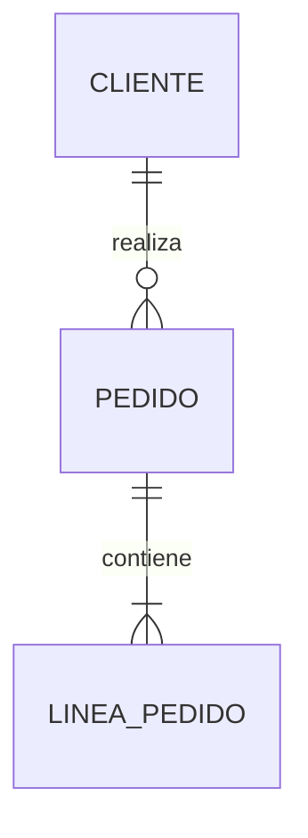

# Registro del modelo de datos

**Autoría y dirección: Pierre R. Boss (oprbguitar). Desarrollo documental asistido por IA.**

Plantilla de [EOS DATA DESIGN](../skills/eos-data-design/SKILL.md). Copiar a `docs/data/DATA-MODEL.md` del destino. Una entidad por bloque de la sección 4. Los valores entre `<>` son marcadores; los no conocidos quedan `PENDIENTE` con responsable.

## 1. Identificación

| Campo | Valor |
|---|---|
| Sistema / servicio | `<nombre>` |
| Motor y versión | `<PostgreSQL 16 / SQLite / …>` — ADR `<id>` |
| Versión del modelo | `<0.1>` |
| Responsable del modelo | `<persona o rol>` |
| Etapa actual | `<1–6>` |

## 2. Glosario

| Término | Definición | Sinónimos | Dueño |
|---|---|---|---|
| `<Cliente>` | `<persona u organización con al menos un pedido>` | `<comprador>` | `<rol>` |

## 3. Diagrama

*(Ejemplo; reemplazar por el modelo real.)*

## 4. Entidad `<servicio.base.esquema.tabla>`

| Campo | Valor |
|---|---|
| Descripción | `<qué representa una fila>` |
| Dominio / dueño | `<ventas> / <rol>` |
| Clave primaria · id público | `<id bigint> · <public_id uuid>` |
| Borrado | `<físico / lógico con retención N días>` |
| Volumen estimado | `<filas/año, crecimiento>` |
| Contrato | `<columnas garantizadas, frescura, consumidores>` |

| Columna | Tipo | Nulo | Restricción | Clasificación | Descripción |
|---|---|---|---|---|---|
| `id` | `bigint` | no | PK | Interno | `<…>` |
| `email` | `text` | no | UNIQUE | PII.Sensible | `<…>` |

**Índices:** `<columna(s)> — consulta que lo justifica>`

**Acceso:** lectura `<roles>` · escritura `<roles>` · enmascarado `<columnas y para quién>`

**Linaje:** origen `<formulario / importación / integración>` → destino `<informe / exportación / IA / backup>`

**Pruebas de calidad:**

| Prueba | Regla | Umbral | Resultado | Fecha |
|---|---|---|---|---|
| Unicidad | `email` único | 0 duplicados | `<PASS/FAIL/NOT_RUN>` | `<AAAA-MM-DD>` |
| No nulos | `email` no nulo | 0 nulos | `<…>` | `<…>` |
| Referencial | `pedido.cliente_id` existe | 0 huérfanos | `<…>` | `<…>` |
| Frescura | última carga | < `<24 h>` | `<…>` | `<…>` |

## 5. Migraciones

| Versión | Archivo | Cambio | Reversible | Probada en | Aplicada en |
|---|---|---|---|---|---|
| `0001` | `<migrations/0001_init.sql>` | `<crea tablas base>` | sí | `<base desechable>` | `<PENDIENTE: requiere autorización>` |

## 6. Decisiones y checkpoints

| Fecha | Etapa | Decisión propuesta | Respuesta del usuario | Estado |
|---|---|---|---|---|
| `<AAAA-MM-DD>` | `1` | `<…>` | `<confirmó / ajustó / pendiente>` | `<abierta/cerrada>` |

## 7. Registro de cambios del modelo

| Versión | Fecha | Cambio | Compatible | Autor |
|---|---|---|---|---|
| `0.1` | `<AAAA-MM-DD>` | Modelo inicial | — | `<rol>` |
